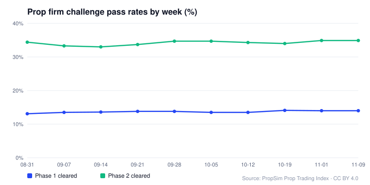
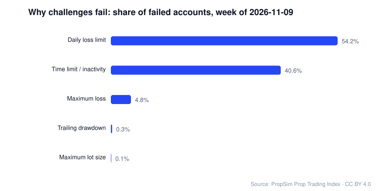
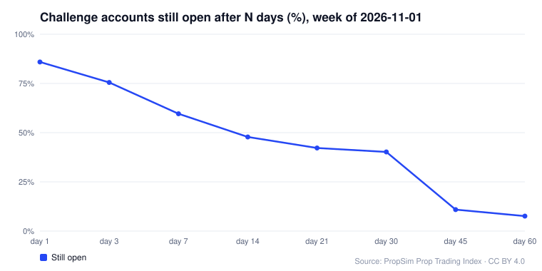

# Prop Firm Pass Rates: Weekly Prop Trading Challenge Statistics (Open Data)

**How many traders pass a prop firm challenge, how long it takes, and why most fail**, as a free weekly dataset. These are the published figures of the [PropSim Prop Trading Index](https://propsim.markets/prop-trading-index?utm_source=github&utm_medium=readme&utm_campaign=prop-firm-pass-rates) in CSV and JSON: phase 1 and phase 2 pass rates, days to pass, failure causes (daily loss, maximum loss, time limits), account survival, retry rates, and how traders who pass differ from traders who fail.

Updated every week · [CSV files](data/) · [Full JSON](data/prop-trading-index.json) · [Interactive version](https://propsim.markets/prop-trading-index?utm_source=github&utm_medium=readme&utm_campaign=prop-firm-pass-rates) · [CC BY 4.0](LICENSE)

## Latest week

<!-- latest:start -->
**Week of 2026-11-09**

| Metric | Value |
|---|---|
| Phase 1 pass rate | 14% |
| Phase 2 pass rate (of those who reached it) | 34.9% |
| Median days to clear a phase | 7.4 days |
| Most common reason a challenge fails | Daily loss limit (54.2% of failed accounts) |
| Accounts still open after 30 days | 39.8% |
| Traders who buy another attempt | 83.8% |
| Win rate: cleared vs failed accounts | 71.5% vs 46% |
| Median account size | $50,000 |
| Median profit split | 80% |
<!-- latest:end -->

These figures describe accounts on firms running the PropSim platform, not every prop firm. See [Methodology](#methodology).

## Charts







## The files

| File | One row per | Columns |
|---|---|---|
| [`data/weekly-summary.csv`](data/weekly-summary.csv) | week | pass rates, days to clear (p25, median, p75), median account size, profit split, duration and leverage, win rates, payoff ratios, median lifespan, retry rate |
| [`data/failure-causes.csv`](data/failure-causes.csv) | week and rule | `week_of`, `rule`, `share_of_failed_accounts_pct` |
| [`data/survival.csv`](data/survival.csv) | week and day | `week_of`, `day`, `still_open_pct` |
| [`data/metrics-long.csv`](data/metrics-long.csv) | week and metric | `week_of`, `metric`, `value`: every published number, named by its path in the JSON |
| [`data/prop-trading-index.json`](data/prop-trading-index.json) | (the whole feed) | the source feed, unchanged |

An empty cell means the figure was not published that week, usually because the sample was too small.

## What the main metrics mean

- **Phase 1 / phase 2 pass rate** (`phase1ClearRatePct`, `phase2ClearRatePct`): the share of accounts that reached their profit target in that phase, including accounts later retired when they moved on to the next phase. Phase 2 is measured among accounts that reached phase 2.
- **Days to clear** (`daysToClear`): how long accounts that passed a phase took, as 25th percentile, median and 75th percentile.
- **Failure causes** (`terminalBreachMixPct`): each failed account is counted once, by the rule that ended it, not by how often a rule fired. `INACTIVITY_MAX_DAYS` is the time limit or inactivity rule.
- **Challenge design** (`challengeDesign`): the typical challenge across firms on the platform: median account size, profit split, maximum duration and leverage.
- **Cleared vs failed** (`tradingDiscipline`): risk per trade as a share of balance, payoff ratio (average win divided by average loss), planned risk:reward and win rate, for accounts that cleared a phase against accounts that breached. These are differences between two groups, not proof that one behaviour causes the other.
- **Settings** (`ruleEfficacy`): pass rate for relaxed challenge settings against tight ones, with the settings named in `relaxedLabel` and `tightLabel`.
- **Survival** (`survival.stillOpenPct`): the share of accounts still open after 1, 3, 7, 14, 21, 30, 45 and 60 days. An account leaves the curve when it passes or breaches.
- **Retries** (`retry`): how many traders buy another attempt after failing, how soon, and the pass rate by attempt number.
- **Behaviour** (`behaviour`): the worst day's share of total loss, commission and swap against gross profit, win rate by trading session, and how long traders wait before their first trade.

## Methodology

From the [index's methodology](https://propsim.markets/prop-trading-index#methodology):

- Figures are drawn from proprietary trading firms running on the PropSim platform. They describe that population, not the prop trading industry as a whole. It includes FullPort Funded, which is PropSim's own firm. The number of firms and accounts behind each figure is not published yet.
- A phase is counted as cleared when the account reached its target, including accounts later retired on progression to the next phase.
- Failure causes count each failed account once, attributed to the rule that terminated it.
- Behavioural figures exclude accounts flagged as automated, accounts driven by an AI trader, accounts whose profile is machine-like (repeatedly closing inside ten seconds), and any position opened when no venue was trading.
- Any metric with too small a sample to be meaningful is withheld rather than published as a number.
- Previously published figures are never restated. Each week is a new snapshot.

## Use the data

Python:

```python
import pandas as pd

base = "https://raw.githubusercontent.com/PropSim-Enterprise/prop-firm-pass-rates/main/data/"
weekly = pd.read_csv(base + "weekly-summary.csv")
causes = pd.read_csv(base + "failure-causes.csv")
print(weekly[["week_of", "phase1_clear_rate_pct", "phase2_clear_rate_pct"]])
```

JavaScript:

```js
const res = await fetch("https://propsim.markets/prop-trading-index/data.json");
const { snapshots } = await res.json();
console.log(snapshots[0].weekOf, snapshots[0].metrics.phase1ClearRatePct);
```

## How to cite

The data is free to reproduce with attribution and a link ([CC BY 4.0](LICENSE)).

- Plain text: `PropSim Prop Trading Index (<week>). https://propsim.markets/prop-trading-index`
- APA: `PropSim. (2026). PropSim Prop Trading Index [Data set]. Retrieved from https://propsim.markets/prop-trading-index`

## Updates

A [GitHub Action](.github/workflows/update.yml) runs every Monday after the index is published, fetches the [public feed](https://propsim.markets/prop-trading-index/data.json) and commits any new week. To rebuild by hand: `node scripts/build.mjs` (Node 20+, no dependencies).

## License

The data is licensed under [Creative Commons Attribution 4.0](LICENSE) by PropSim. The build script may be reused under the MIT license.

---

Made by [PropSim](https://propsim.markets/?utm_source=github&utm_medium=readme&utm_campaign=prop-firm-pass-rates), white-label prop firm software. Related: [free prop firm landing page templates](https://github.com/PropSim-Enterprise/prop-firm-landing-page-templates).
